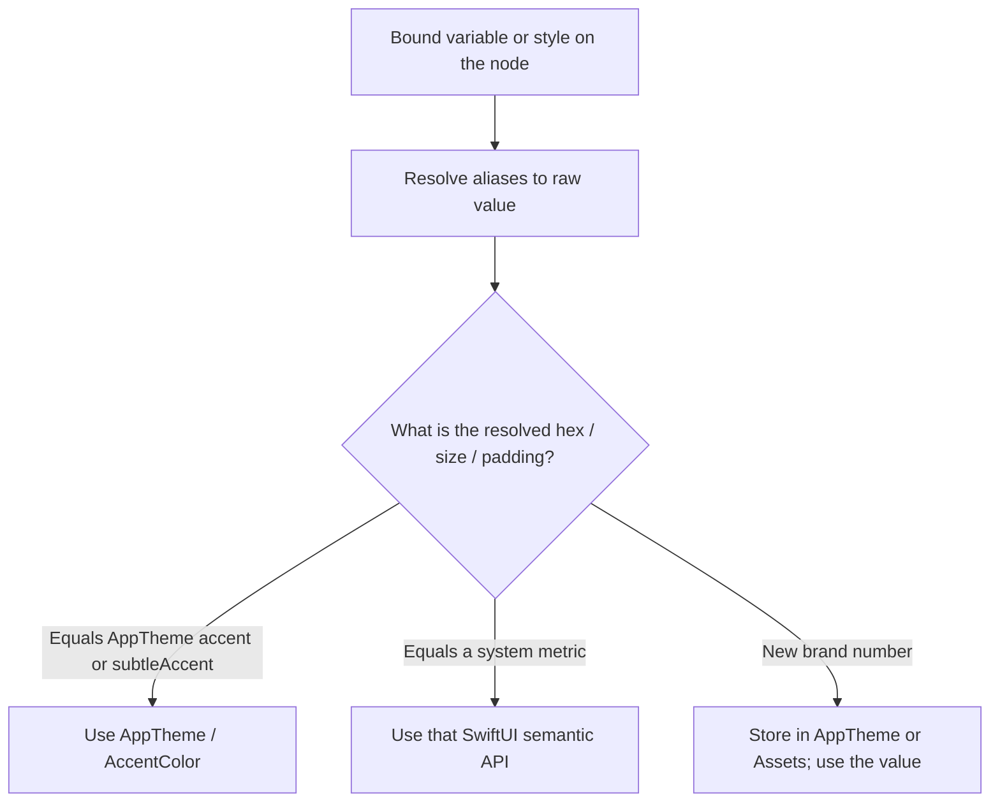
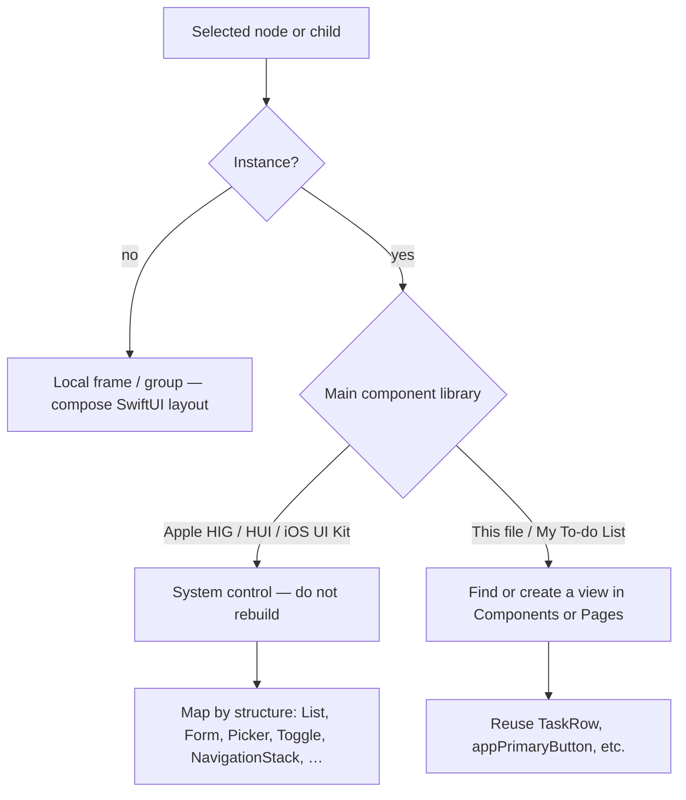
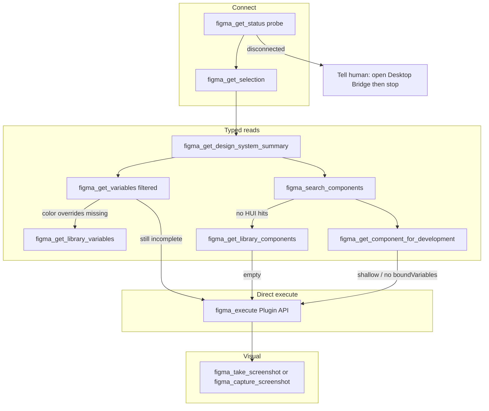

# AGENTS.md — Pixel to SwiftUI

How an agent should turn Figma frames into code in **My To-do List**.

This is a native iOS 17+ SwiftUI + SwiftData app. Designs live in Figma, built on Apple’s **HIG / HUI** library, with **app color styles overridden**. Typography, spacing, radii, materials, and system controls stay on HIG tokens. **HUI token names are unreliable** — always read the resolved raw value on the node (see §4.1). Some UI is local to this file; some is HUI library instances. Fetch each source on purpose — never assume every node is custom.

Cursor cannot show SwiftUI Canvas. After UI work, the human verifies in **Xcode**.

**Figma reads use Figma Console MCP (`user-figma-console`) only.** If Desktop Bridge is not connected, stop (§6.1). Do not use the official Figma MCP as a fallback.

---

## 1. Goal

Produce SwiftUI that matches the Figma screenshot **and** the HIG semantics underneath it: `List` / `Form` / `NavigationStack` / system controls, `AppTheme` for brand color, Dynamic Type, dark mode, and accessibility.

Do **not** transliterate Figma’s React/Tailwind or absolute pixel frames into `ZStack` + `.offset`.

---

## 2. Design sources of truth

| Layer | Where it lives in Figma | Where it lives in code |
|---|---|---|
| Brand / accent colors (overrides) | File-local color styles / variables that replace HIG accent | `AppTheme` + `AccentColor` in Assets |
| Semantic HIG colors (labels, fills, backgrounds, separators) | HUI / Apple HIG library tokens | `Color.primary`, `.secondary`, `Color(.systemBackground)`, `Color(.separator)`, … |
| Type, spacing, radius, materials | HUI text styles and layout tokens | SwiftUI semantic fonts (`.body`, `.headline`, …) and system containers |
| System chrome (nav bar, list, form, segmented control, toggle, date picker, toolbar) | HUI library instances | Native SwiftUI APIs |
| App-specific compositions | Local components / frames in the product file | `Pages/` (screens) + `Components/` (local widgets) + `Styles/AppTheme` |

**Color overrides are the exception. Everything else is HIG unless a bound variable or local component proves otherwise.**

If a node uses a HIG-looking **style name** but the **resolved value** is this app’s purple (or another override), map that **value** through `AppTheme`. Never “correct” the design because the HUI name does not match Apple’s docs.

---

## 3. Repo map

```
MyToDoList/
  App/          MyToDoListApp.swift, PreviewSupport.swift
  Models/       TodoTask.swift, UserProfile.swift
  API/          ← every external network API lives here, one subfolder per provider
    ImageSearching.swift                 ← provider-agnostic contract: protocol, ImageCandidate, ImageSearchError
    Unsplash/   UnsplashClient.swift (requests, transport, error mapping, key from Info.plist)
                UnsplashModels.swift (response DTOs → ImageCandidate)
                VisualAttribution.swift (required "Photo by … on Unsplash" credit + UTM links)
  Services/     TaskRepository.swift, TaskGrouping.swift
                VisualQueryBuilder.swift (+ privacy guard), PhotoSelector.swift,
                TaskVisualService.swift   ← on-device task-visuals logic; talks to API/ only via ImageSearching (FRD §5–§8)
  Styles/       AppTheme.swift          ← brand color + shared button chrome
  Pages/        screens (composers, covers, sheets)
  Components/   local reusable UI
  Assets.xcassets/AccentColor.colorset
Config/         App.xcconfig, App-Info.plist, Secrets.xcconfig.example   ← build config; Secrets.xcconfig is gitignored
scripts/        sync-secrets.sh          ← .env → Config/Secrets.xcconfig (access key only)
```

| Screen / piece | File | Pattern |
|---|---|---|
| Root gate | `Pages/RootView.swift` | Profile exists → list; else welcome. `.tint(AppTheme.accent)` |
| Welcome (name) | `Pages/AuthViews.swift` → `WelcomeView` | Local layout, not a HIG screen template |
| Task list | `Pages/TaskListView.swift` | Composer: `NavigationStack` + `List` of local cards + HUI segmented control / Add / sort `Menu` |
| Empty list | `Components/TaskListEmptyState.swift` | Local empty (glyph + copy); not `ContentUnavailableView` unless it matches the frame |
| Date group | `Components/TaskDateHeader.swift` | Local hairline + date label between card groups |
| Task row | `Components/TaskRow.swift` | Local **card** inside `List` (thumbnail, meta, footer). Subviews: thumbnail / meta / footer. Thumbnail: Unsplash photo when loaded; neutral shimmer while `pending` or `AsyncImage` loading; category SF Symbol on `subtleAccent` for terminal fallback states |
| New / edit task | `Pages/TaskEditorView.swift` | `Form` in a full-screen cover |
| Reinstate | `Pages/ReinstatementSheet.swift` | Local sheet, medium detent |
| Parked auth | `SignUpView`, forgot-password in `AuthViews.swift` | Not in launch flow |

`TodoTask` carries optional `visual*` fields (query, Unsplash photo id, hotlinked image URL, attribution, status). They are the data source for the task thumbnail. Do not invent a parallel image model. Field list: FRD §7.

Existing brand tokens (keep in sync when Figma accent changes):

```swift
enum AppTheme {
    static let accent = Color(red: 142 / 255, green: 31 / 255, blue: 253 / 255)
    static let subtleAccent = Color(red: 243 / 255, green: 240 / 255, blue: 1)
    static let cardBorder = Color(uiColor: .separator).opacity(0.45)
    static let priorityHigh = Color(red: 199 / 255, green: 117 / 255, blue: 1 / 255)
    static let priorityMedium = Color(red: 187 / 255, green: 149 / 255, blue: 0 / 255)
}
```

Put **new** reusable chrome in `Styles/AppTheme` or a new type in `Components/`. New screens go in `Pages/`. New external APIs go in `API/<Provider>/` (client + response models), with tests in `MyToDoListTests/API/`. Do not scatter one-off hex values across files.

Homepage **list vs card:** keep a SwiftUI `List` (swipe actions, one scroll). Draw Figma’s card chrome on each row (clear row background, hidden separators). Do not rebuild the page as `ScrollView` + `LazyVStack` unless Console proves there is no list container.

### 3.1 Homepage icons (file-local SVG)

Exported via Console `exportAsync` from [Icons](https://www.figma.com/design/5VmhfDHcwNxosjckYiaAEu/To-do-App?node-id=105-1808) (`105:1808`). Use `Image("AssetName")` as template. Do not replace with SF Symbols.

| Asset | Figma | Size | Used on |
|---|---|---|---|
| `FunnelSimple` | `50:5227` FunnelSimple | 24 | Header sort `Menu` in `subtleAccent` circle |
| `ListCheck` | `51:5239` list-check | 24 | Empty state glyph |
| `CalendarSchedule` | `84:3185` calendar-schedule-line | 24 | Row footer due / missed |
| `EditPencil` | `104:1569` Edit | 24 | Row Edit action |

Still in the Icons section, **not on the current homepage screens** (sort menu still uses SF Symbols): `flag` `84:3184`, `alert` `84:3183`, `tag` `84:3182`, `calendar` `84:3181`, `clock` `84:3180`. Paste those later if sort icons should match Figma.

**Checkbox** is local `TaskCheckbox` (16pt rounded square, gray stroke / gray fill + check) from component set `50:4957`, not an SVG in `105:1808`. Hairlines and 3pt bullets are `Divider` / `Circle`.

---

## 4. Token resolution

Walk this order for every color, type style, and numeric token. **Names are labels only. The bound raw value is what you implement.**



Ignore HUI / collection **names** at every step. An unreadable name is not a blocker if a raw value exists.

### 4.1 Confusion: HUI token names are not a spec

Apple’s HUI library names are often opaque, aliased, abbreviated, or reused in ways that do **not** line up with Human Interface Guidelines vocabulary (`labels/secondary`, `Title 2 / Emphasized`, and so on). Agents routinely fail here by:

- Treating the **string name** as the mapping (e.g. a style called “Fill / Primary” must become `Color.primary`)
- Flagging **naming inconsistency** (token name says one thing, paint looks like another)
- Skipping a token because the path does not match a table in this file
- Trusting Tailwind `var(--…)` paths, REST codegen, or the official Figma MCP over the value actually bound on the node (read via Console)

**Rule: resolve and implement the attached raw value. Do not audit or interpret HUI nomenclature.**

| Do | Do not |
|---|---|
| `figma_get_variables` with `resolveAliases: true`, or `figma_execute` `valuesByMode` / `boundVariables` → resolved paint | Map from collection path or style name alone |
| Read **fills, strokes, opacity, fontSize, fontWeight, lineHeight, padding, itemSpacing, cornerRadius** on the node after styles resolve | Argue that a HUI name is “wrong” for this screen |
| If the hex equals `AppTheme.accent` / `subtleAccent`, use those types | Rename or “fix” tokens in Figma unless the user asked |
| If the rgba/size matches a system metric, you *may* use `Color.secondary` / `.body` as the equivalent of that value | Reject a match because the HUI name is not `labels/secondary` or `Body/Regular` |
| If the name is garbage but the value is `#8E1FFD`, ship `AppTheme.accent` | Leave a TODO “unclear token name” |

Raw value means, in order:

1. Resolved variable (`resolveAliases` / `resolvedValuesByMode` / `figma.variables.getVariableById` + `valuesByMode` for the current mode).
2. Else the paint or numeric on the node after Figma applied the style (`fills[0].color`, `fontSize`, `paddingLeft`, …).
3. Else the node’s visible fill/stroke after styles apply, as read from Console (`figma_execute` / screenshot). Never invent values from the official Figma MCP.

When Light/Dark modes exist, resolve **both** modes’ raw values. Still ignore mode *names* if they are cryptic; use the color/number stored in each mode.

### 4.2 Colors

1. Resolve the bound color to **RGBA / hex** (and opacity).
2. Compare that value to `AppTheme` and to system metrics — not to the HUI name.
3. **App override** — resolved purple / lavender (this file: accent `rgb(142, 31, 253)`, subtle `rgb(243, 240, 255)`). Map to `AppTheme` or `Assets.xcassets`, including Light/Dark if the raw values differ by mode.
4. **System-looking values** — if the resolved rgba is the usual HIG metric, SwiftUI semantic colors are allowed as the implementation of that value (dark mode then comes for free):

   | Typical resolved look | SwiftUI (equivalent of the value) |
   |---|---|
   | White / system canvas | `Color(.systemBackground)` |
   | Grouped gray canvas | `Color(.secondarySystemBackground)` |
   | Primary label (near-black / near-white by mode) | `Color.primary` |
   | Secondary label (~60% gray) | `Color.secondary` |
   | Hairline separator | `Color(.separator)` |
   | Faint fill | `Color(.quaternarySystemFill)` |

   Use this table only as **value → API**. If the name says “separator” but the hex is the brand purple, implement purple.

5. **Never** remap a custom purple to `Color.purple` or stock `accentColor`.
6. Interactive controls that use the brand tint should inherit `.tint(AppTheme.accent)` from `RootView` when possible.

### 4.3 Typography

Do not parse HUI text-style **names** (tight/loose prefixes, numbered styles, “emphasized” variants that do not mean semibold). Read **font family, size, weight, leading** on the text node (or the resolved text style’s raw metrics).

If those metrics match a Dynamic Type style, use the semantic font. If they do not, still honor the **numbers** (prefer `.font(.body)`-class mapping when size/weight match the canonical spec below) — do not skip the node because the style is named oddly.

| Canonical size + weight (raw) | SwiftUI |
|---|---|
| 34 Medium | `.largeTitle` |
| 28 Medium | `.title` |
| 22 Regular | `.title2` |
| 20 Regular | `.title3` |
| 17 Semibold | `.headline` |
| 17 Regular | `.body` |
| 16 / 15 / 13 / 12 / 11 | `.callout` / `.subheadline` / `.footnote` / `.caption` / `.caption2` |
| Weight ~590 / Semibold | `.fontWeight(.semibold)` |
| Weight ~510 / Medium | `.fontWeight(.medium)` |

Ignore SF Pro tracking quirks (`letterSpacing: -0.43`). Prefer semantic fonts over `.system(size:)` when the raw size matches the table.

### 4.4 Spacing and radius

Read **padding, gap, cornerRadius** as numbers (including from bound FLOAT variables after alias resolve). If the number is the system list/form inset, omit extra `.padding`. If it is a custom number, apply that number. Do not infer spacing from a HUI token name like “Spacing / M”. Do not copy Tailwind `px-4` onto every `List` row.

---

## 5. Component resolution (local vs HUI)

Frames mix **local** components and **HUI library** instances. Classify before writing Swift.



### 5.1 Treat as HUI → native SwiftUI

Recognize by **structure + Console screenshot + instance main component (library name)**, not by a single string.

| Figma / HUI shape | SwiftUI |
|---|---|
| Grouped table / rounded section cards | `List` + `.listStyle(.insetGrouped)` |
| Labeled fields, toggles, pickers stacked in sections | `Form` |
| Large title + back + trailing actions | `NavigationStack` + `.navigationTitle` + `.toolbar` |
| Segmented control | `Picker` + `.pickerStyle(.segmented)` |
| Switch | `Toggle` |
| Date and time row | `DatePicker` |
| Bottom add / compose in toolbar | `ToolbarItem(placement: .bottomBar)` |
| Status bar / home indicator / device bezel | Discard — system chrome |

Do not rebuild a HUI button, segmented control, or nav bar from `HStack` + `Capsule`.

### 5.2 Treat as local → project views

Local in this app today:

- Welcome hero (checklist glyph in `AppTheme.subtleAccent` circle + name field + Continue)
- `TaskListEmptyState` (empty pending / completed copy + file-local glyph)
- `TaskDateHeader` (date between card groups)
- `TaskRow` (local card: thumbnail, title, category · priority, trailing checkbox, alarm + Edit footer)
- `ReinstatementSheet`
- `.appPrimaryButton()` (full-width filled CTA)
- Outlined secondary CTA on the sheet (stroke with `AppTheme.accent`)
- Header funnel accessory: local circle + file-local SVG wrapping a HUI `Menu` (sort)

Do not wrap HUI `Picker` / `Button` / nav title in dummy Swift types. Those stay system APIs on `TaskListView`.

If Figma has a **local** component with the same role, extend that Swift view. Do not create a parallel widget.

### 5.3 Code Connect (Console only)

If Console `figma_get_component_for_development` (or a SwiftUI snippet on the node) maps to this repo, use that type. If the snippet is a HIG JSX stub (`Button - Content Area`, `Segmented control`, `Header`), map to the system control. **Do not** pull Code Connect from the official Figma MCP.

---

## 6. Figma Console MCP — how to call tools

Namespace: **`user-figma-console` only** for reading and writing this Figma file.

**Forbidden:** the official Figma MCP (`plugin-figma-figma`: `get_design_context`, `get_metadata`, `get_screenshot`, `download_assets`, and the rest) as a substitute when Desktop Bridge is down, when a Console tool is empty, or to “save a round trip.” Do not implement a frame from that MCP’s React/Tailwind dump or its screenshots.

### 6.1 Always start connected — or stop

1. `figma_get_status` with `probe: true`.
2. If disconnected: tell the human. Do **not** guess HUI vs local, do **not** substitute SF Symbols for file icons, do **not** keep implementing the Figma task.
3. Recovery (print these, then wait):
   - Open the product file in **Figma Desktop**.
   - Plugins → Development → **Figma Desktop Bridge** → Run.
   - Wait a few seconds (plugin scans ports 9223–9232).
4. After they confirm: probe again. Then `figma_list_open_files` / `figma_navigate`, then `figma_get_selection` or `figma_execute` to the URL node id.
5. Optional: `figma_reconnect` only if the plugin is already running and the socket is stale.

Node IDs go stale across sessions. Re-read selection or search; do not reuse IDs from an old chat.

### 6.2 Escalation ladder (use this every time a typed tool is thin or empty)

Generic helpers first. **If the result is empty, truncated, missing library data, or clearly wrong, do not retry the same call.** Step down **inside Console**. Never jump to official Figma MCP.



| Need | Try first | If that fails |
|---|---|---|
| Inventory of DS | `figma_get_design_system_summary` | `figma_execute` listing collections + local components |
| App color overrides | `figma_get_variables` `format: filtered`, `includePublished: false`, `resolveAliases: true`, `namePattern` for accent/brand | `figma_get_styles` then execute `getStyleById` / node `boundVariables` |
| HIG tokens from subscribed libraries | `figma_get_library_variables` (`libraryName` ~ HIG / Apple / iOS) | `figma_execute` → `figma.teamLibrary.getAvailableLibraryVariableCollectionsAsync()` |
| Is this node HUI or local? | `figma_search_components` in the open file; `figma_get_library_components` for the HIG file key if known | `figma_execute` on the instance: `mainComponent`, `parent`, `getMainComponentAsync()`, library name |
| Implement one component | `figma_get_component_for_development` with `codebasePath` = this repo’s `MyToDoList` (`Components/` or `Pages/`) | `figma_get_component_for_development_deep`, then execute a tree dump of auto-layout + `boundVariables` |
| Bound **raw** colors / numbers on a node | `figma_get_variables` `resolveAliases: true` + node `boundVariables` | `figma_execute` resolver (below). Names are optional metadata. |
| Token inventory (human browsing) | `figma_get_token_values` / filtered variables | Execute; still return **values**, not names-only |
| After code exists | `figma_check_design_parity` (`canonicalSource: design`) | Human compares Xcode to Console screenshot |
| Export icons / SVG | `figma_execute` `exportAsync` on the icon frame | Document name + node id in §3.1 for the human to paste into Assets |

`figma_browse_tokens` is for the human UI — do not treat it as the agent’s token dump.

`figma_ds_extract_tokens` mines **codebases** (CSS/Tailwind). Skip it for this SwiftUI app unless you are pushing tokens **back** into Figma.

Homepage frames to re-read on Console after Bridge is up (do not use stale chat IDs without `figma.getNodeById`):

- Icons: `105:1808`
- Pending empty: `105:1810`
- Pending filled: `105:1818`
- Completed tab: `105:1836`

### 6.3 `figma_execute` — when and how

Use when typed tools return `[]`, omit published HIG variables, cannot see instance overrides, or need bound variable IDs resolved on a **specific node**.

Rules:

- Read-only inspection for pixel-to-code (no document edits unless the user asked to change Figma).
- Return a **small JSON**: ids, **resolved raw values**, and names only as debug. Do not serialize entire pages. Never return names without values.
- For instances, read `componentProperties` / main component — do not assume `characters` is writable or complete.
- Check `resultAnalysis.warning` on the tool result.

Example: classify the selection and resolve color bindings.

```javascript
const sel = figma.currentPage.selection[0];
if (!sel) return { error: "nothing selected" };

async function libraryOf(node) {
  if (node.type !== "INSTANCE") return { kind: "local-or-frame", name: node.name, type: node.type };
  const main = await node.getMainComponentAsync();
  return {
    kind: "instance",
    instanceName: node.name,
    mainName: main?.name,
    mainId: main?.id,
    remote: main ? main.remote : null,
  };
}

function rgb(c) {
  if (!c) return null;
  return {
    r: Math.round(c.r * 255),
    g: Math.round(c.g * 255),
    b: Math.round(c.b * 255),
    a: c.a,
  };
}

function resolveVar(id) {
  const v = figma.variables.getVariableById(id);
  if (!v) return { id };
  const raw = {};
  for (const [mode, val] of Object.entries(v.valuesByMode || {})) {
    if (val && val.type === "VARIABLE_ALIAS") raw[mode] = resolveVar(val.id);
    else if (val && val.r != null) raw[mode] = rgb(val);
    else raw[mode] = val;
  }
  return { id: v.id, name: v.name, resolvedType: v.resolvedType, raw };
}

function boundRaw(node) {
  const binds = node.boundVariables || {};
  const out = {};
  for (const [field, ref] of Object.entries(binds)) {
    const id = ref && (ref.id || (Array.isArray(ref) ? ref[0] && ref[0].id : null));
    out[field] = id ? resolveVar(id) : ref;
  }
  return out;
}

const fill = sel.fills && sel.fills[0];
return {
  node: { id: sel.id, name: sel.name, type: sel.type },
  classification: await libraryOf(sel),
  boundResolved: boundRaw(sel),
  paintIfUnbound: fill && fill.type === "SOLID" ? rgb(fill.color) : null,
  textRaw: sel.type === "TEXT" ? { fontSize: sel.fontSize, fontWeight: sel.fontWeight, fontName: sel.fontName } : null,
};
```

Example: list **file-local** color variables with **resolved paints**, not names only.

```javascript
function rgb(c) {
  return { r: Math.round(c.r * 255), g: Math.round(c.g * 255), b: Math.round(c.b * 255), a: c.a };
}
const out = [];
for (const c of figma.variables.getLocalVariableCollections()) {
  for (const id of c.variableIds) {
    const v = figma.variables.getVariableById(id);
    if (!v || v.resolvedType !== "COLOR") continue;
    const raw = {};
    for (const [mode, val] of Object.entries(v.valuesByMode || {})) {
      raw[mode] = val && val.r != null ? rgb(val) : val;
    }
    out.push({ collection: c.name, name: v.name, id: v.id, raw });
  }
}
return out;
```

If `getLocalVariableCollections` is empty but the UI clearly uses tokens, the values are **library** tokens — call `figma_get_library_variables` or teamLibrary in execute.

### 6.4 Visual truth and icons (Console only)

- Screenshots: `figma_take_screenshot` or `figma_capture_screenshot` (plugin `exportAsync`). That is the pixel check.
- Icons: export the file-local SVG/PDF via Console and commit (or document in §3.1). **`Image(systemName:)` only when Console shows a HUI instance whose main component is an SF Symbol.** Do not “closest SF Symbol” a Phosphor / custom SVG.
- After code exists: `figma_check_design_parity` (`canonicalSource: design`) if available on Console; otherwise human checks Xcode vs Console screenshot.

---

## 7. Pixel-to-code workflow

```mermaid
sequenceDiagram
  participant U as User
  participant A as Agent
  participant C as Figma Console
  participant R as Repo

  U->>A: Implement this frame / selection
  A->>C: figma_get_status probe
  alt Bridge down
    A->>U: Recovery steps then stop
  else Connected
    A->>C: navigate selection summary variables
    A->>C: classify each instance local vs HUI
    alt typed tool empty
      A->>C: figma_execute targeted inspect
    end
    A->>C: figma_take_screenshot
    A->>R: match Pages / Components / AppTheme / models
    A->>R: write idiomatic SwiftUI
    A->>C: optional design parity
    A->>U: HIG vs AppTheme vs file assets; verify in Xcode
  end
```

Step by step:

1. **Connect** (`probe: true`) or **stop** (§6.1). Target the frame (selection or URL node id via `figma_execute`).
2. **Tokens** — resolve **raw values** on each node via Console. Match hex/metrics to `AppTheme` or system APIs. Do not map from HUI names.
3. **Components** — walk the tree; tag HUI vs local (`getMainComponentAsync`); reuse `TaskRow` / `Form` / `List` as above.
4. **Navigation scaffold** if several screens: `RootView` already gates welcome vs list; new flows should be `sheet` / `fullScreenCover` / `NavigationLink` consistent with existing presentation (editor is full-screen cover, reinstate is sheet).
5. **Implement** in the matching file; keep SwiftData models as the data source (`TodoTask`, `UserProfile`). Do not invent a parallel UI model.
6. **Chrome** — drop device bezels; use toolbar APIs for nav actions. Homepage: `List` + local card rows.
7. **Parity** — Console screenshot vs implementation; flag missing Assets instead of substituting SF Symbols or stock photos. A stock photo is legitimate **only** as a task visual produced by the visuals pipeline (FRD §5). It is never a stand-in for an un-exported Figma icon, illustration, or empty-state asset.

Figma parity for the thumbnail: `TaskRow` component set `82:1370` already has a thumbnail slot. When comparing with `figma_check_design_parity`, compare the **photo thumbnail** state (60pt, 8pt radius, `scaledToFill`) as well as the shimmer loading state and the symbol fallback. The symbol on `subtleAccent` remains the correct render for terminal non-photo statuses.

---

## 8. SwiftUI implementation rules

**Do**

- `List` / `Form` for repeating rows and settings-style editors. Homepage: `List` with **local card** row content (hidden separators, clear row fill).
- Semantic fonts and system colors **when the resolved size/rgba matches**; otherwise the raw brand value via `AppTheme`.
- File-local icons: `Image("AssetName")` after Assets paste / Console export. `Image(systemName:)` only for confirmed HUI SF Symbols.
- `#Preview` next to the view (see existing files).
- Accessibility identifiers already used in UI tests (`welcome.name`, `welcome.continue`, `task.add`, `task.title`, `task.save`).
- Task thumbnail: a **fixed 60pt frame** with `scaledToFill` and an 8pt rounded clip, so a late-arriving photo cannot shift layout. Keep the existing 0.55 dim on completed rows for both photo and symbol.
- Task visuals are resolved on the **editor-save path** (`TaskEditorView` → `TaskRepository` → `TaskVisualService`). A row only renders a persisted URL.
- A `ready` visual must be able to surface its credit: `Photo by {name} on Unsplash`, with UTM-tagged links, on the row context menu and one line in the editor (FRD §8.2).
- Keep the task title as the accessible label. The photo is decorative or carries `visualAlt`; it never replaces the title.
- Load the photo from its stored `images.unsplash.com` URL (hotlinking). The access key comes from `Info.plist` (derived from the gitignored `Secrets.xcconfig`); never hardcode it.

**Do not**

- Start a network request from `TaskRow.body`, `onAppear`, or a `ForEach` over tasks. No search, no download ping, no image prefetch from the list. The only network a row may trigger is `AsyncImage` drawing the already-stored `visualImageURL` inside `TaskRowThumbnail`.
- Remove, hide, or restyle away the photo credit. It is a provider requirement, not decoration.
- Download, re-host, or write Unsplash images to disk.
- Embed or reference `UNSPLASH_SECRET_KEY` anywhere in the app target. Only the access key is used.
- Show a stock photo where Figma specifies an icon or illustration (see §7 step 7).

- Absolute `left` / `top` from Tailwind.
- `Color.black` / `Color.white` as screen backgrounds.
- Hand-drawn `Divider` **between `List` rows** (card inner dividers on `TaskRow` are local and allowed).
- Custom tab bar or nav bar `HStack`.
- Rebuild HUI controls that already match system appearance.
- Hardcoded `.system(size:)` when a text style exists.

Welcome / sheet CTAs that are **local** may keep `RoundedRectangle(cornerRadius: 10)` via `.appPrimaryButton()` — that is product chrome, not a HUI button instance.

```swift
// HUI scroll chrome → List. Local card content → TaskRow.
List {
    ForEach(section.tasks) { task in
        TaskRow(task: task, toggleCompletion: { … }, delete: { … }, reinstate: { … }, edit: { … })
            .listRowSeparator(.hidden)
            .listRowBackground(Color.clear)
    }
}

// Brand fill is an override, not Color.accentColor from the system default.
Button("Continue") { … }
    .appPrimaryButton()

// Resolved rgba was secondary-label gray — implement the value with the system API.
Text("What should we call you?")
    .foregroundStyle(.secondary)
```

---

## 9. Done when

- [ ] HUI instances mapped to system SwiftUI, not custom clones
- [ ] Every bound token implemented from **resolved raw values** (aliases followed); HUI names not used as the spec
- [ ] No “token name inconsistent with HIG” nits — values compared to `AppTheme` / system metrics only
- [ ] Color overrides (by hex, not by name) in `AppTheme` / `AccentColor`
- [ ] Remaining colors/type/spacing use HIG semantic APIs **when the raw value matches** those metrics
- [ ] Existing view types reused; models unchanged unless the design adds real fields
- [ ] Typed **Console** tools used first; `figma_execute` when they were empty; Console screenshot compared
- [ ] Official Figma MCP **not** used as a fallback
- [ ] File-local icons exported or documented in §3.1 — not replaced with guessed SF Symbols
- [ ] Leftover device chrome not implemented
- [ ] Task thumbnail states checked in Xcode: `ready` (photo), `pending` (shimmer), `fallback` / `privacyBlocked` / `noResults` / `skippedNoKey` / `idle` (symbol), completed (dimmed)
- [ ] No network call added to `TaskRow.body`, `onAppear`, or a list `ForEach`
- [ ] Photo credit reachable for every `ready` visual; `UNSPLASH_SECRET_KEY` not referenced in the app target
- [ ] Human can check Canvas / simulator in Xcode

If Desktop Bridge is down: say so, print §6.1 recovery steps, **stop**. Do not guess library vs local. Do not continue the Figma-backed task until the human reconnects.
